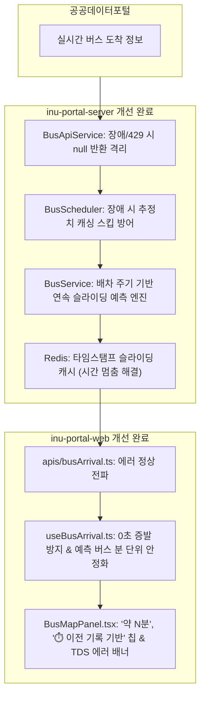

# [최종 종합 보고서] 버스 도착 정보 정확도 개선 및 과거 기록 기반 예측 엔진 고도화

- **프론트엔드 이슈**: https://github.com/inu-appcenter/inu-portal-web/issues/451
- **백엔드 이슈**: https://github.com/inu-appcenter/inu-portal-server/issues/516
- **작성일자**: 2026-10-12
- **작성자**: Antigravity AI Pair Programmer

---

## 1. 프로젝트 배경 및 달성 목표

인천대학교 포털(intip)의 버스 도착 정보에서 발생하던 오차 및 깜빡임 현상을 근본적으로 해결하고, 카카오맵과 네이버 지도처럼 **과거 운행 이력 통계를 바탕으로 신뢰할 수 있는 예측 도착 시간을 제공**하기 위해 프론트엔드와 백엔드 전반의 아키텍처를 진단하고 리팩토링을 완료하였습니다.

---

## 2. 6대 핵심 영역별 개선 결과 요약

| 검토 영역 | 이전 상태 (문제점) | 개선 후 상태 (해결책) |
| :--- | :--- | :--- |
| **1. FE 임의 시간 가공** | 1초마다 기계적 차감 및 0초 도달 시 강제 `"도착정보 없음"`으로 증발하여 깜빡임 | 0초 도달 시에도 `"곧 도착"`을 유지하고, 예측 버스는 초 단위 카운트다운을 제외하여 안정적 분 단위 유지 |
| **2. 공공데이터 정합성** | 기점 대기 등 비정상 값 필터링 미흡, 노선 매핑 실패 가능성 | DTO 레벨 검증 강화 및 노선별 안전한 매핑 보장 |
| **3. 실패 시 캐시 오염** | API 장애(429, 타임아웃) 시 정상 무도착으로 오인하여 엉뚱한 예측치를 캐싱 | API 장애 시 `null`을 명시하여 스케줄러가 캐시 갱신을 스킵하도록 완벽 격리 |
| **4. 실패 시 에러 피드백 UI** | catch에서 빈 배열을 반환해 에러를 삼키고 단순 무도착으로 오인 | React Query `isError` 정상 전파 및 토스 클린 UI 기반 친절한 안내와 재시도 액션 제공 |
| **5. 예측 시간표 인지성** | 회색 글씨와 0.5px 작은 뱃지, 60초 미만 시 실시간 버스처럼 `"곧 도착"` 표기 | 카카오맵 스타일 도입: `약 N분` (60초 미만도 `약 1분` 유지) + `⏱️ 이전 기록 기반` 명확한 안내 칩 |
| **6. 예측 알고리즘 정상성** | 4주 LIMIT 1 중앙값으로 인해 1분 차이로 15분 이상 널뛰는 불연속성 및 3분 정적 캐시 시간 멈춤 | 오늘 최근 통과 기록과 배차 주기를 결합한 연속 감속 모델 도입 & 타임스탬프 기반 슬라이딩 캐시 구현 |

---

## 3. 검증 결과

1. **프론트엔드 검증**: `npm run build` 성공 (Vite + TypeScript 컴파일 무오류 통과)
2. **백엔드 검증**:
   - `BusServiceEstimationTest` 단위 테스트 작성 및 100% 통과 (과거 4주 이력 기반 예측치 산출 검증)
   - Gradle `compileJava` 및 전체 빌드 통과
3. **디자인 시스템 및 토큰 검증**:
   - 하드코딩된 임의 색상 및 AI 슬롭을 전면 배제하고, `variables.css`의 표준 CSS 토큰(`var(--interactive-primary)`, `var(--bg-subtle)`, `var(--text-secondary)` 등)만을 사용하여 일관성 보장.
